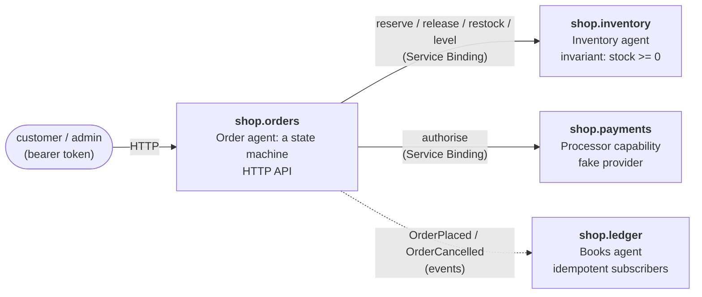

# shop

A small online shop in Bynk, split into four bounded contexts that talk over
Service Bindings and events. It is a showcase and a test: the
[org canary](https://github.com/bynk-lang/.github/blob/main/canary/README.md)
re-runs its checks, including end-to-end scenarios against the running Workers,
on every new Bynk release.

## The shape



| Context | Shows | Source |
| --- | --- | --- |
| `shop.orders` | an agent as a **state machine** (`Pending → Opened → Placed / Rejected → Cancelled`); a service that coordinates other contexts; **authentication and authorisation** (a `Customer`, and an `Admin` refined by a token claim: `401` vs `403`); emitting **events** | [`orders.bynk`](src/shop/orders.bynk) |
| `shop.inventory` | an agent with an **invariant** (`available >= 0`) enforced at every commit; `on call` services with the **`Caller`** identity | [`inventory.bynk`](src/shop/inventory.bynk) |
| `shop.payments` | a **capability** (`Processor`) with a provider (`FakeProcessor`), the seam a real processor would fill | [`payments.bynk`](src/shop/payments.bynk) |
| `shop.ledger` | **event subscribers** (`from Events(…)`), made safe for at-least-once delivery with `Idempotency` | [`ledger.bynk`](src/shop/ledger.bynk) |

The agent owns an order's state and the rules for moving it. The service around
it does the cross-context work: reserve stock, take payment, release the stock
again if the payment is declined, emit the event.

## The API

Every route but the stock ones needs a bearer token (HS256, signed with
`AUTH_JWT_SECRET`) whose `sub` is the caller. The stock routes and the ledger
need a token with an `admin` claim.

| Route | Who | What |
| --- | --- | --- |
| `PUT /orders/:id` | customer | Place order `:id`: `{"sku":"widget","qty":3,"cents":2500}`. `201` placed, `409` out of stock or already decided, `422` payment declined. The id is the customer's, so placing it twice cannot place it twice. |
| `GET /orders/:id` | the order's customer | The order. Someone else's is a `404`. |
| `POST /orders/:id/cancel` | the order's customer | Cancel a placed order and return its stock. |
| `PUT /stock/:sku` | admin | Add `{"qty":10}` to a product's stock. |
| `GET /stock/:sku` | admin | A product's stock. |
| `GET /totals` (on `shop.ledger`) | admin | Standing orders, units and cents, as the ledger saw them in events. |

Payments over 1,000.00 (`cents > 100000`) are declined by the fake processor.

## Run it

```sh
bynkc test .                                       # unit tests
bynk dev -- --var AUTH_JWT_SECRET:dev-secret       # all four contexts, wired
```

`bynk dev` prints each context's port. They are assigned in name order, so
`shop-inventory` is first and `shop-orders` is on the third.

## Tests

- **Unit tests** ([`tests/shop`](tests/shop)) drive the agents and the payment
  rule directly: stock arithmetic and the refusal that keeps it non-negative,
  every transition of the order's state machine, and the processor's limit.
- **End-to-end scenarios** ([`e2e/scenarios.sh`](e2e/scenarios.sh)) run against
  the four Workers served by `bynk dev`, through
  [`bynk-dev`](https://github.com/bynk-lang/bynk-dev). They place, refuse,
  decline and cancel orders and check the stock after each; check that
  authentication fails as `401` and authorisation as `403`; and poll the ledger
  until its events have been counted.

  ```sh
  AUTH_JWT_SECRET=dev-secret bynk dev -- --var AUTH_JWT_SECRET:dev-secret &
  AUTH_JWT_SECRET=dev-secret \
  BYNK_DEV_URL_SHOP_ORDERS=http://localhost:8789 BYNK_DEV_URL_SHOP_LEDGER=http://localhost:8788 \
    ./e2e/scenarios.sh
  ```

CI runs both on every push and pull request at a pinned Bynk version
(`0.330.4`), so a red build means a change broke something. The canary runs
them at each new release; when a release breaks the shop it opens a `canary`
issue here.

## What Bynk can't do for this yet

Where this example works around the language, or the toolchain falls short, it
is written down here rather than hidden:

- **An agent can't call another context.** The `Order` agent would naturally
  call the inventory itself, but that faults at runtime
  ([accuser/bynk#1960](https://github.com/accuser/bynk/issues/1960)), so the
  `api` service does the cross-context calls and the agent keeps to its own
  state.
- **Events and `bynk deploy` don't compose.** Orders emit to the ledger, and a
  subscriber must consume the emitter, so the generated Service Bindings form a
  cycle and the deploy is refused
  ([accuser/bynk#1961](https://github.com/accuser/bynk/issues/1961)). Until it
  is fixed, [`deploy.yml`](.github/workflows/deploy.yml) is manual and the
  canary skips its deploy dry run.
- **No `system`-tier test of the whole flow.** `bynkc test`'s `system` tier
  stands the contexts up in process, but only `on call` services are
  addressable, and it wires no event fan-out
  ([accuser/bynk#1959](https://github.com/accuser/bynk/issues/1959)). The
  end-to-end scenarios cover the flow against the real Workers instead.

## Deploying

Not yet; see above. When it works, [`deploy.yml`](.github/workflows/deploy.yml)
needs these repository secrets:

| Secret | Value |
| --- | --- |
| `CLOUDFLARE_API_TOKEN` | A Cloudflare API token with Workers deploy scope. |
| `CLOUDFLARE_ACCOUNT_ID` | The Cloudflare account ID. |
| `AUTH_JWT_SECRET` | The key tokens are verified with. |

## License

Licensed under either of [MIT](LICENSE-MIT) or [Apache-2.0](LICENSE-APACHE) at
your option.
