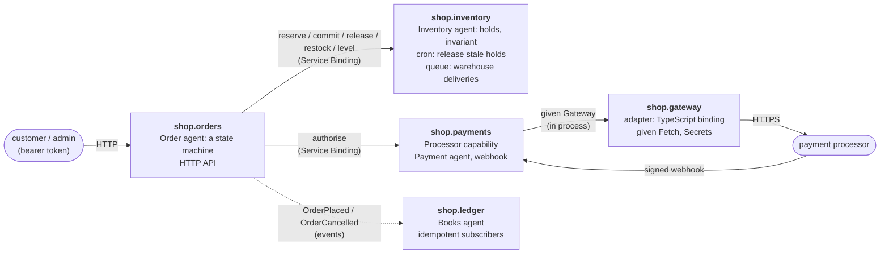

# shop

A small online shop in Bynk, split into four bounded contexts that talk over
Service Bindings and events, with one adapter that takes payments from a
payment processor's HTTP API. It is a showcase and a test: the
[org canary](https://github.com/bynk-lang/.github/blob/main/canary/README.md)
re-runs its checks, including end-to-end scenarios against the running Workers,
on every new Bynk release.

## The shape



| Context | Shows | Source |
| --- | --- | --- |
| `shop.orders` | an agent as a **state machine** (`Pending → Opened → Placed / Rejected → Cancelled`); a service that coordinates other contexts; **authentication and authorisation** (a `Customer`, and an `Admin` refined by a token claim: `401` vs `403`); emitting **events** | [`orders.bynk`](src/shop/orders.bynk) |
| `shop.inventory` | an agent with an **invariant** (`available >= 0`) enforced at every commit; a **`Map`** of holds stamped with the **`Clock`**, read back with a **`Query`**; a **cron** entry point that releases stale holds; a **queue** consumer for the warehouse's deliveries, deduped by id in a **`Log`**; `on call` services with the **`Caller`** identity | [`inventory.bynk`](src/shop/inventory.bynk) |
| `shop.payments` | a **capability** (`Processor`) whose provider is composed from an adapter's capability and `Secrets`, with a fake for tests and local runs; a `Payment` agent whose history is a **`Log`** with **`@retain`**; a webhook authenticated by a **`Signature`** actor | [`payments.bynk`](src/shop/payments.bynk) |
| `shop.gateway` | an **adapter**: the `Gateway` capability declared in Bynk, implemented in a **TypeScript binding** against a payment processor's HTTP API, with `Fetch` and `Secrets` as capability dependencies | [`gateway.bynk`](src/shop/gateway.bynk), [`gateway.binding.ts`](src/shop/gateway.binding.ts) |
| `shop.ledger` | **event subscribers** (`from Events(…)`), made safe for at-least-once delivery with `Idempotency` | [`ledger.bynk`](src/shop/ledger.bynk) |

The agent owns an order's state and the rules for moving it. The service around
it does the cross-context work: reserve stock, take payment, commit the stock
if the payment is authorised or release it if not, emit the event.

That compensation is by hand, so it is not crash-safe: a Worker that dies
between reserving the stock and settling the payment leaves the stock held.
Each hold records when it was made, and a cron job in `shop.inventory` releases
holds older than fifteen minutes every five. If it releases one whose request
was only slow, the order's `commit` finds no hold and the order is rejected
rather than overselling.

## Payments

`shop.payments` charges through its `Processor` capability. A context has one
provider per capability, so the provider, `CardProcessor`, chooses from
configuration:

- `PAYMENTS_PROCESSOR=fake` uses the fake processor, a pure function: charges
  over 1,000.00 (`cents > 100000`) are declined, and the authorisation id is
  `fake_<order id>`. Tests and `bynk dev` use it.
- Anything else, including unset, goes to the real processor through the
  `shop.gateway` adapter, which reads `PAYMENTS_API_KEY` (and optionally
  `PAYMENTS_API_URL`) from `Secrets`. Without a key it fails closed: the charge
  is `Unavailable` and the order is a `503`.

The processor is generic but real-shaped:
`POST /v1/authorisations` with a bearer key, an `Idempotency-Key` (the order
id), and `{"amount", "currency", "reference"}`; `201 {"id", "status":
"authorised"}` or `402` for a declined card.

It calls back with webhooks, `POST /webhooks/processor` on `shop.payments`,
signed with HMAC-SHA256 over `<timestamp>.<body>` using
`PAYMENTS_WEBHOOK_SECRET`, in `X-Processor-Signature` and
`X-Processor-Timestamp`. A missing, forged or more than five-minute-old
signature is a `401` before the body is read. The body is
`{"id", "event", "payment"}`, where `event` is `payment.captured`,
`payment.failed` or `payment.refunded`. Each payment keeps its notices in a
`Log` for 90 days, which is also how a retried notice is recognised and
answered without being applied twice. A notice that does not follow from the
payment's status is a `409`, and the processor retries it.

## The API

Every route but the stock ones needs a bearer token (HS256, signed with
`AUTH_JWT_SECRET`) whose `sub` is the caller. The stock routes and the ledger
need a token with an `admin` claim.

| Route | Who | What |
| --- | --- | --- |
| `PUT /orders/:id` | customer | Place order `:id`: `{"sku":"widget","qty":3,"cents":2500}`. `201` placed, `400` if a field fails its type (a zero `qty`, an empty `sku`), `409` out of stock or already decided, `422` payment declined. The id is the customer's, so placing it twice cannot place it twice. |
| `GET /orders/:id` | the order's customer | The order. Someone else's is a `404`. |
| `POST /orders/:id/cancel` | the order's customer | Cancel a placed order and return its stock. |
| `PUT /stock/:sku` | admin | Add `{"qty":10}` to a product's stock. |
| `GET /stock/:sku` | anyone | Whether a product is in stock: `{"kind":"InStock"}` or `{"kind":"SoldOut"}`. A customer sees how many are left: `{"kind":"Left","count":10}`. |
| `GET /totals` (on `shop.ledger`) | admin | Standing orders, units and cents, as the ledger saw them in events. |
| `POST /webhooks/processor` (on `shop.payments`) | the payment processor (signed) | A notice about a payment: `{"id":"evt_1","event":"payment.captured","payment":"auth_123"}`. `200` with the payment's new status, `409` if it does not follow, `401` unsigned or stale. |

`PUT /orders/:id` is `422` when the card is declined and `503` when the
processor cannot be asked.

## Run it

```sh
bynkc test .                                       # unit tests
node --test tests/bindings/*.test.cjs              # the adapter's binding, after bynkc test
bynk dev -- --var AUTH_JWT_SECRET:dev-secret \
  --var PAYMENTS_PROCESSOR:fake --var PAYMENTS_WEBHOOK_SECRET:dev-hook \
  --test-scheduled                                 # all four contexts, wired
```

`--test-scheduled` lets you run the sweeper on demand:
`curl "http://localhost:8787/__scheduled?cron=*/5+*+*+*+*"`.

`bynk dev` prints each context's port. They are assigned in name order, so
`shop-inventory` is first and `shop-orders` is on the third.

## Tests

- **`system` suites** ([`tests/shop`](tests/shop), `*_system.bynk`) stand the
  contexts up as the Workers they deploy as and test across the wire: the
  whole order flow from orders through inventory and payments, the payments
  context with and without the fake processor, and the webhook's refusal of an
  unsigned or forged notice.
- **Unit tests** ([`tests/shop`](tests/shop)) drive the agents and services
  directly: stock arithmetic and the refusal that keeps it non-negative, holds
  and the sweeper (with a stubbed `Clock` and a scheduled time), every
  transition of the order's state machine, the fake processor's limit, the
  real path with `Gateway` stubbed, and the payment's webhook transitions and
  replay guard.
- **Binding tests** ([`tests/bindings`](tests/bindings)) test the adapter's
  TypeScript binding as TypeScript, with Node's test runner, against fake
  `Fetch` and `Secrets`: the request it sends, and how it reads each answer.
- **End-to-end scenarios** ([`e2e/scenarios.sh`](e2e/scenarios.sh)) run against
  the four Workers served by `bynk dev`, through
  [`bynk-dev`](https://github.com/bynk-lang/bynk-dev). They place, refuse,
  decline and cancel orders and check the stock after each; check that
  authentication fails as `401` and authorisation as `403`; poll the ledger
  until its events have been counted; send the payment webhook signed, forged,
  stale and twice; and run the sweeper.

  ```sh
  bynk dev -- --var AUTH_JWT_SECRET:dev-secret --var PAYMENTS_PROCESSOR:fake \
    --var PAYMENTS_WEBHOOK_SECRET:dev-hook --test-scheduled &
  AUTH_JWT_SECRET=dev-secret PAYMENTS_WEBHOOK_SECRET=dev-hook \
  BYNK_DEV_URL_SHOP_INVENTORY=http://localhost:8787 BYNK_DEV_URL_SHOP_LEDGER=http://localhost:8788 \
  BYNK_DEV_URL_SHOP_ORDERS=http://localhost:8789 BYNK_DEV_URL_SHOP_PAYMENTS=http://localhost:8790 \
    ./e2e/scenarios.sh
  ```

CI runs both on every push and pull request at the Bynk version in
[`BYNK_VERSION`](BYNK_VERSION), so a red build means a change broke something.
The canary runs them at each new release. When a release breaks the shop it
opens a `canary` issue here; when a newer release passes, it opens a pull
request moving `BYNK_VERSION` to it.

## What Bynk can't do for this yet

Where this example works around the language, or the toolchain falls short, it
is written down here rather than hidden. (The shop was first written against
Bynk 0.330.4 and worked around a dozen more; all were fixed by 0.371.3, and the
history has them.)

- **Events are delivered once, in the request.** The orders fan-out delivers
  each event to the ledger before the order's response, with one attempt and
  no retry: a failed delivery is logged and the ledger misses it. The ledger
  dedups on the event id with `Idempotency`, whose provider remembers only as
  long as the isolate does.
- **One provider per capability.** There is no way to pick a provider per
  environment, so `CardProcessor` reads `PAYMENTS_PROCESSOR` and chooses at
  run time. The fake is a pure function rather than a provider of its own.
- **The gateway can't void an authorisation yet.** If the sweeper releases a
  hold while its payment is being taken, the order is rejected but the
  authorisation stands until the processor lets it lapse.
- **Bynk can't send to a queue.** Producing queue messages isn't a first-party
  capability, so `stock-deliveries` is fed by the warehouse's own Worker, and
  nothing in this repository can put a message on it under `bynk dev`. The
  consumer is tested with `deliveries.message(…)`.
- **The sweeper visits every sku.** Durable Objects can't be listed, so a
  `Catalogue` agent records each sku that has been stocked, and every run asks
  each one for its stale holds. That is fine at this size; a large catalogue
  would want an index of skus with open holds.

## Deploying

[`deploy.yml`](.github/workflows/deploy.yml) runs a dry run on every pull
request, and deploys on a push to `main` once these repository secrets exist
(until then it warns and skips):

| Secret | Value |
| --- | --- |
| `CLOUDFLARE_API_TOKEN` | A Cloudflare API token with Workers deploy scope. |
| `CLOUDFLARE_ACCOUNT_ID` | The Cloudflare account ID. |
| `AUTH_JWT_SECRET` | The key tokens are verified with. |
| `PAYMENTS_API_KEY` | The payment processor's API key. |
| `PAYMENTS_WEBHOOK_SECRET` | The key the processor signs its webhooks with. |

Leave `PAYMENTS_PROCESSOR` unset in a deployment, so the real processor is
used (the plan lists it as a `read` secret and warns that it has no value).
Set `PAYMENTS_API_URL` to point the gateway at a sandbox.

`bynk deploy` can't see the gateway binding's reads, `PAYMENTS_API_KEY` and
`PAYMENTS_API_URL`, because the binding is TypeScript; its plan says payments'
secrets are incomplete. `deploy.yml` checks the required key itself. If it is
missing anyway, every order is a `503` and payments logs `processor
unavailable for <order>`.

`deploy.yml` sets `PAYMENTS_API_KEY` in a second run, for `shop.payments`
alone. A name passed to `bynk deploy` with `--secrets-file` or `--secret` is
set on every context in the run, and the processor's key has no business on
inventory or orders. The actors' secrets come from the environment instead,
which `bynk deploy` sets only on the context that declares them. The keys that
sign the calls between contexts are minted and set by `bynk deploy` itself.

## License

Licensed under either of [MIT](LICENSE-MIT) or [Apache-2.0](LICENSE-APACHE) at
your option.
